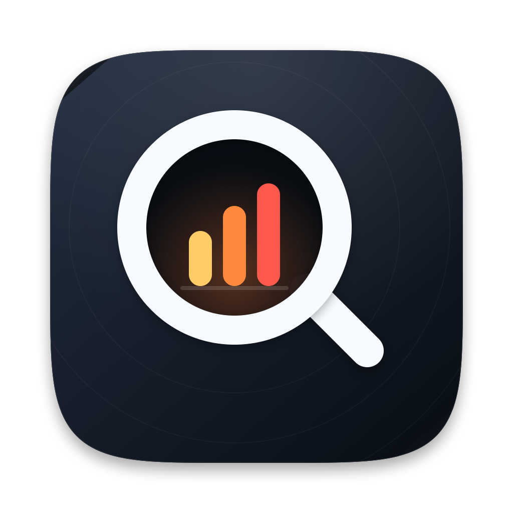

<p align="center">
  
</p>

<h1 align="center">负载侦探 LoadLens</h1>

<p align="center">
  用大白话告诉你「电脑为什么变慢、风扇为什么响、硬盘被谁占满了」的 macOS 菜单栏小工具。<br>
  内置 AI 助手，能自己查数据、深入分析。
</p>

<p align="center">
  
  
  
</p>

---

## 功能一览

**系统监控**（菜单栏常驻 CPU 圆环 + 百分比，点击打开面板）

- 状态总览：一句话结论、CPU 大数字、趋势曲线（平均值 / 峰值 / 负载）
- 内存、温度、磁盘三个指标卡；悬停看交换区、压缩内存等细节
- 占用排行：同一应用的多个进程合并成一项，可直接退出应用、在访达中显示
- 诊断建议：根据当前状态给出能马上做的事
- 持续高负载 2 分钟时发系统通知（30 分钟内不重复打扰）
- 硬盘空间监控（齿轮 →「硬盘空间监控…」，默认关闭，规则可自定义）：
  - 空间快速减少时提醒，并说明这段时间写入最多的程序
  - 每天空闲时把家目录量一遍，某个文件夹持续变大时提醒，并尽量定位到最深的那一层子文件夹

**硬盘管理**（面板顶部切到「硬盘」）

- 启动盘容量（已用 / 可自动清除 / 空闲）、SMART 健康状态、本地 Time Machine 快照
- 实时读写速度、趋势曲线、读写最多的应用；外接磁盘一键推出
- 可清理空间分析：下载、废纸篓、应用缓存、日志、Xcode、iOS 模拟器、开发工具缓存、iPhone 备份各占多少，只读大小、不删除任何文件

**AI 助手**（贴在面板旁边展开）

- 支持 DeepSeek、OpenAI、Claude、Gemini、Kimi、通义千问、智谱、硅基流动、OpenRouter、本地 Ollama 和任意兼容接口
- 能自己调用只读工具查数据：比如「应用缓存里都是哪些应用」，它会查出每个文件夹属于哪个应用、应用是否已卸载，再告诉你哪些能放心清理
- 硬盘页每一项旁的 ✨、占用排行里的「问 AI」，一键深入分析

**其他**：开机自启、复制诊断报告、终端体检命令。

## 快速开始

### 环境要求

- macOS 13 Ventura 或更高版本（Apple 芯片和 Intel 都可以）
- Xcode 命令行工具（只需要 `swiftc`，不需要完整的 Xcode）。没有的话先运行 `xcode-select --install`

### 安装

```bash
git clone https://github.com/YYaa18/loadlens.git
cd loadlens
./install.sh
```

脚本会编译、安装到 `~/Applications/负载侦探.app` 并启动，菜单栏右上角会出现一个圆环和 CPU 百分比。编译大约需要 1 分钟。

可选：安装前先运行一次 `./tools/setup-signing.sh`，它会在本机钥匙串里创建一个只在本机使用的自签名证书。以后每次编译都用它签名，「完全磁盘访问权限」等系统授权在重新编译后不会丢。

### 让 AI 帮你安装

用 Claude Code、Cursor、Codex 等 AI 编程工具时，把下面这段话发给它即可。仓库里的 [AGENTS.md](AGENTS.md) 写好了完整的安装、验证和排错步骤：

```text
请帮我安装负载侦探（LoadLens）：https://github.com/YYaa18/loadlens
克隆仓库后按照仓库里 AGENTS.md 的步骤安装并验证，完成后告诉我结果，以及接下来需要我自己做什么。
```

### 卸载

```bash
./uninstall.sh            # 退出并删除应用、移除开机自启，保留设置和 API Key
./uninstall.sh --purge    # 连同设置和钥匙串里的 API Key 一起删除
```

## 使用指南

### 主面板

点菜单栏的圆环打开面板。底部固定的「AI 助手」按钮在两个页面都一样，点一下打开 / 收起 AI 助手。右上角齿轮里有：开机自动启动、持续高负载时通知、硬盘空间监控、AI 模型设置、复制诊断报告、打开活动监视器、退出。

面板会根据屏幕高度自适应：屏幕放不下时，顶部和底部固定、中间的卡片可以滚动，小屏幕上图表和排行会更紧凑；AI 助手的高度也不会超出屏幕，输入框始终可见。

### 硬盘页

点面板顶部的「硬盘」，或者点概览页的「磁盘」卡片。点「开始分析」统计可清理空间；应用缓存可能有几十万个小文件，第一次统计需要几十秒，大目录会显示实时进度。每一项右侧的文件夹图标可以在访达中打开，✨ 可以让 AI 分析这一项里都有什么。

### AI 助手

**1. 配置模型**：齿轮 →「AI 模型设置…」，左侧选服务、填 API Key，点「获取模型列表」和「测试连接」，再点「设为当前模型」。

| 服务 | 接口格式 |
| --- | --- |
| DeepSeek、OpenAI、Google Gemini、Kimi、通义千问、智谱 GLM、硅基流动、OpenRouter | OpenAI 兼容（`/chat/completions`） |
| Anthropic Claude | Anthropic 原生 Messages 接口（`/v1/messages`） |
| Ollama（本地） | OpenAI 兼容，无需 Key |
| 自定义 | 可选 OpenAI 兼容或 Anthropic 格式，适合公司网关、LM Studio、vLLM 等 |

**2. 开始对话**：点面板底部的「AI 助手」，AI 助手在面板旁边展开（右侧放得下就在右侧，否则在左侧）。打开时不会自动提问：空白页会按当前页面给出建议问题（概览页问卡顿、风扇、内存，硬盘页问清理、缓存、健康），也可以点「一键分析」或直接输入。Return 发送，Shift+Return 换行；顶部模型名可以随时切换；需要大窗口时点右上角的窗口图标。

**3. AI 能自己查数据**：回答里会显示它查了什么（例如「✓ 查看「应用缓存」明细」）。所有工具都是只读的，AI 不能删除文件或结束进程，只会告诉你去哪里操作。

| 工具 | 能查到什么 |
| --- | --- |
| `list_apps` | 所有应用按 CPU / 内存 / 磁盘读写排序 |
| `get_app_processes` | 某个应用下的每个进程 |
| `get_memory_details` | 内存、压缩内存、交换区、占内存最多的应用 |
| `get_disk_details` | 所有磁盘的容量、健康、快照、读写速度 |
| `get_space_overview` | 可清理空间总览（没分析过会自动分析） |
| `analyze_folder` | 目录里每个子文件夹的大小、所属应用、应用是否已卸载 / 正在运行、最近修改时间 |
| `get_history` | 最近几分钟 CPU 或硬盘读写的趋势 |
| `get_folder_growth` | 最近哪些文件夹在变大（需要开启「文件夹持续变大」监控） |
| `get_system_info` | 型号、芯片、macOS 版本、运行时间等 |

不支持工具调用的模型会自动退回普通对话。使用 Anthropic 官方接口和 Claude Opus / Sonnet 5.5 等模型时，会自动开启服务端 `fallbacks`：请求被安全策略拒绝时，由服务端换用其他模型重试。

## 隐私与权限

- **不需要** sudo、辅助功能或屏幕录制权限；不读取任何文件的内容，只读文件大小。
- **只有 AI 功能会联网**，而且只连你选择的服务。每次提问会发送当前的 CPU、内存、温度、占用最高的应用名和本机建议；AI 调用工具时会额外发送查到的结果（应用名、进程名、文件夹名和大小）。AI 助手顶部「AI 实时读取」→「详情」可以看到完整内容。对话只保存在内存里，退出即清空。
- **API Key** 存在 macOS 钥匙串，不写入任何文件。为了重新编译后不再反复弹授权框，Key 以「本机任何应用都可读取」的方式保存，代价是同一用户下运行的其他程序也能读到（安全性接近配置文件）。
- **可选的系统授权**：统计「下载」时系统可能询问一次；废纸篓、iPhone 备份受隐私保护，需要在「系统设置 → 隐私与安全性 → 完全磁盘访问权限」里允许负载侦探才能统计；通知需要在首次开启时允许。开启「文件夹持续变大」后，第一次扫描时系统可能询问能否访问桌面、文稿等文件夹，不允许的会跳过。

## 资源占用

| 状态 | 采样频率 | 实测 CPU |
| --- | --- | --- |
| 面板关闭 | 每 6 秒，整机总量和本用户进程 | 约 0.2% |
| 面板打开 | 每 5 秒，额外读取系统进程和每个进程的磁盘读写 | 约 0.7% |

- 进程数据来自系统 `libproc` 接口，不启动 `top`；系统进程用 `ps` 兜底，CPU 每 30 秒、进程名每 5 分钟刷新。
- 硬盘健康最多 30 分钟读一次；可清理空间只在点击「开始分析」时统计，用和 `du` 相同的 `fts` 遍历，多个位置并行。
- 「实时」脉冲点由 Core Animation 绘制，不会让界面每帧重绘。

## 开发

```bash
./build.sh                                              # 编译到 build/LoadLens.app
open build/LoadLens.app                                 # 直接运行（不安装）
./build/LoadLens.app/Contents/MacOS/LoadLens --diagnose # 终端体检，不开界面
```

<details>
<summary>开发用命令行参数</summary>

| 参数 | 作用 |
| --- | --- |
| `--diagnose` | 在终端打印一次完整体检 |
| `--tool-test <工具名> '<JSON 参数>'` | 用实时数据运行一个 AI 工具，打印结果 |
| `--disk-watch [秒数] [GB] [分钟]` | 测试硬盘空间监控：用临时规则运行，有提醒时直接打印（不保存设置、不发通知） |
| `--notify-test` | 打印通知权限状态，并发一条测试通知 |
| `--llm-test <模型.gguf>` | 加载本地模型，跑三个实验：KV 缓存前缀复用、读题与生成的速度、采样温度的影响 |
| `--folder-scan` | 把家目录量一遍，打印用时和最大的文件夹（不保存） |
| `--folder-growth-selftest` | 在临时目录里自测「文件夹持续变大」的定位和去重逻辑，通过时打印 PASS |
| `--preview-window [秒]` | 把面板放在普通窗口里显示，便于截图 |
| `--render-preview <路径>` | 把面板离屏渲染成 PNG |
| `--ai-preview` | 启动后直接打开 AI 独立窗口并分析一次 |
| `--settings-preview` | 直接打开 AI 模型设置窗口 |
| `--keychain-test` / `--keychain-save <账户>` / `--keychain-read <账户>` | 钥匙串读写自检 |
| `--login-item-on` / `--login-item-off` | 开关开机自启 |

| 环境变量 | 作用 |
| --- | --- |
| `LOADLENS_AI_MOCK=1` | AI 返回固定的演示内容，不联网 |
| `LOADLENS_DISKWATCH_DEBUG=1` | 硬盘空间监控每次检查都打印剩余空间、减少量和当前规则 |
| `LOADLENS_AI_KEY=<key>` | 临时给当前服务指定 Key |
| `LOADLENS_SETTINGS_SUITE=<名字>` | 使用独立的设置和钥匙串条目，测试时不影响真实配置 |
| `LOADLENS_DOCK_SIDE=left` | 强制 AI 助手在面板左侧展开 |
| `LOADLENS_MAX_HEIGHT=600` | 假装屏幕只有这么高，用来检查小屏幕上的布局 |

</details>

<details>
<summary>数据来源</summary>

| 指标 | 来源 |
| --- | --- |
| 整机 CPU | `host_processor_info` tick 差值 |
| 单进程 CPU / 内存 | `proc_pidinfo(PROC_PIDTASKINFO)` 差值 |
| 系统进程 | `/bin/ps -axo pid=,pcpu=,rss=,comm=`（仅面板打开时） |
| 内存 / 压缩内存 | `host_statistics64` + `sysctl vm.swapusage` |
| 温度状态 | `ProcessInfo.thermalState` |
| 负载 / 运行时间 | `getloadavg` / `sysctl kern.boottime` |
| 磁盘容量 | `URLResourceKey.volumeAvailableCapacityForImportantUsage` 等 |
| 整机读写速度 | IOKit `IOBlockStorageDriver` 的 Statistics |
| 单进程读写 | `proc_pid_rusage`（仅本用户进程） |
| 硬盘健康 / 本地快照 | `diskutil info -plist /`、`tmutil listlocalsnapshots /` |
| 可清理空间 | `fts` 遍历常见目录，只读文件大小 |
| 通知 | `UserNotifications`（首次开启时请求授权） |
| 开机自启 | `~/Library/LaunchAgents/local.loadlens.agent.plist` |
| AI | 用户选择的服务，流式返回（OpenAI 兼容 / Anthropic Messages），支持工具调用 |

</details>

<details>
<summary>目录结构</summary>

```
Sources/
  App.swift / main.swift     菜单栏入口、命令行参数
  Monitor.swift              定时采样、历史曲线、通知
  Sampler.swift              CPU / 内存 / 进程采样
  Model.swift                进程合并、应用归组、ps 兜底
  Disk.swift                 磁盘容量、读写速度、健康状态
  SpaceScanner.swift         可清理空间分析
  Diagnoser.swift            诊断规则与建议
  DiskWatch.swift            空间快速减少提醒
  FolderGrowth.swift         每日文件夹大小记录与持续变大提醒
  DiskWatchView.swift        「硬盘空间监控」设置窗口
  Views.swift                主面板界面
  DiskViews.swift            「硬盘」页界面
  Theme.swift                配色、卡片与通用控件
  AIDock.swift               AI 助手贴在面板旁边展开
  AIChat.swift               AI 对话状态与上下文
  AIChatView.swift           AI 对话界面
  AIChatWindow.swift         AI 独立窗口
  AISettingsView.swift       AI 模型设置窗口
  AIProviders.swift          预置模型服务与配置存储
  AITools.swift              AI 可调用的只读工具
  LLMClient.swift            流式客户端与工具调用（OpenAI 兼容 / Anthropic）
  LocalModel.swift           内嵌 llama.cpp 的本地模型推理（KV 缓存复用、采样）
  MarkdownText.swift         AI 回复的 Markdown 渲染
  Keychain.swift             API Key 存取
  LoginItem.swift            开机自启
  Notifier.swift             系统通知
  CLI.swift                  终端体检与开发用预览
Resources/                   图标
tools/
  setup-signing.sh           创建本机自签名证书（可选）
  fetch-llama.sh             下载固定版本的 llama.cpp 预编译框架到 vendor/（build.sh 自动调用）
  IconGen.swift              图标生成器
build.sh / install.sh / uninstall.sh
AGENTS.md                    给 AI 编程工具看的安装与开发说明
```

</details>

<details>
<summary>图标</summary>

深色圆角底 + 白色放大镜，镜片里是三根从黄到红、逐渐升高的柱子：放大镜代表“侦探”，递增的暖色柱子代表正在升高的负载。源文件是 `Resources/icon_1024.png`，打包用 `Resources/AppIcon.icns`。重新生成：

```bash
swiftc -O -parse-as-library tools/IconGen.swift -o /tmp/icongen
/tmp/icongen Resources/icon_1024.png
```

</details>

## 已知限制

- 不读取风扇转速和具体温度（需要 SMC 或 `sudo powermetrics`，为了零权限暂时没做）；温度只有「正常 / 偏热 / 过热」这样的状态。
- 系统进程的 CPU 来自 `ps` 的近期平均值；它们的磁盘读写读不到，只能看到整机总量；没有拆分 GPU 占用。
- 趋势曲线和对话只保存在内存里，退出应用后清空。
- AI 需要自备对应服务的 API Key（本地 Ollama 除外），按各家标准计费。预置的模型名可能随厂商更新而过时，用「获取模型列表」拉取最新列表即可。

## 许可协议

本项目采用 [PolyForm Noncommercial License 1.0.0](LICENSE.md)。

- ✅ **个人、学习、研究、非营利组织使用**：免费，可以随意下载、修改和分享（分享时请保留 `LICENSE.md`）。
- 💼 **商业用途**（公司内部使用、集成到收费产品或服务、二次售卖等）：需要另外获得商业授权，请在 GitHub 上[提交 Issue](https://github.com/YYaa18/loadlens/issues) 联系作者。

Copyright © 2026 YYaa18
